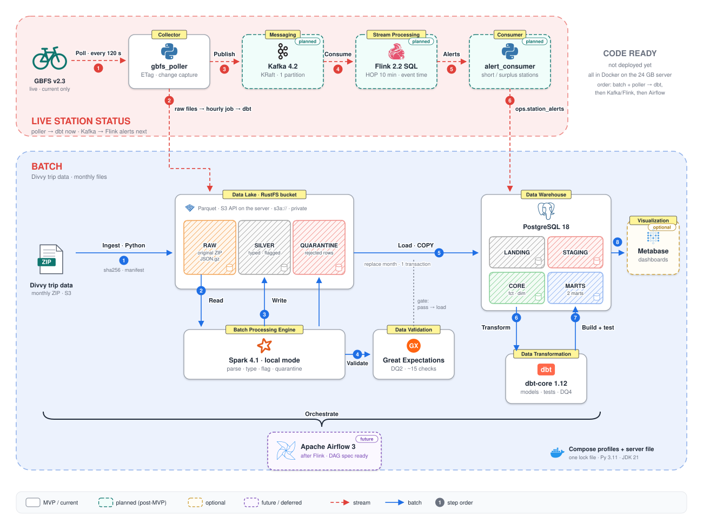
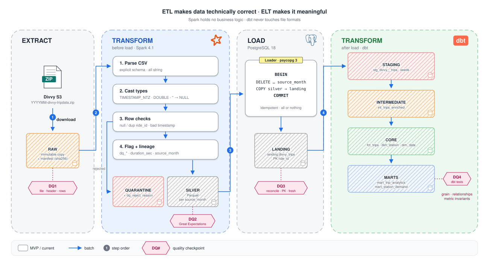
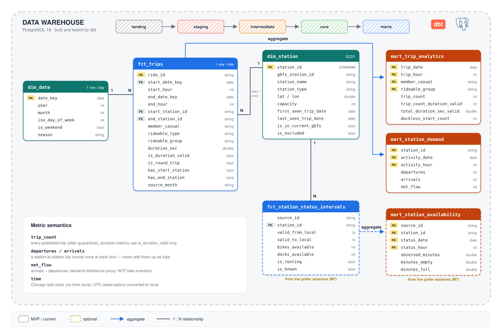

# Divvy Data Platform

[← Back to Portfolio](../index.md)

!!! info "Status: in progress"
    The server-track code is implemented and its deployment is in progress. The cloud track is designed but not yet built.

## Description

An end-to-end data engineering project (team project) on **Divvy**, Chicago's bike-share system. It combines:

- a monthly **trip batch pipeline**: Spark ETL into an S3-compatible lake, then PostgreSQL and dbt marts;
- **live station status** collected from the public GBFS feed;
- **near-real-time alerts** for stations that run out of bikes or docks (Kafka + Flink).

Every step is an idempotent CLI with a fixed exit-code contract.

## Architecture

| **Track** | **What** | **Status** |
|---|---|---|
| **A · Server (Docker Compose)** | Everything runs as Docker Compose services on one Linux host: PostgreSQL 18, RustFS (S3-compatible lake), the Spark / Great Expectations / dbt tools image, the GBFS poller, Kafka, Flink and the alert consumer. | Code complete · server deployment in progress |
| **B · Cloud (GCP)** | Cloud Storage lake, Cloud Run Jobs running the same tools image, BigQuery + dbt, Cloud Scheduler. | Architecture only — future implementation |

### Data flows

**Batch — trip files (monthly).**

1. Download the ZIP and check its integrity, header and row count.
2. Transform it with **Spark** into typed Parquet in the lake. Rows that cannot be parsed go to a quarantine area with a reason; nothing is dropped silently.
3. Validate it with **Great Expectations**.
4. Load it into PostgreSQL with `DELETE partition + COPY` in one transaction, and reconcile row counts.
5. Build the **dbt** models.

**Live — station status.** A poller reads the GBFS v2.3 `station_status` feed every 2 minutes with conditional requests and stores each new feed version as a raw file in the lake. An hourly job compacts those files into a snapshot plus change events, and dbt turns them into station state intervals.

**Streaming — alerts.** The poller also publishes every station of every feed version to Kafka. A **Flink SQL** job uses 10-minute event-time windows that slide every 2 minutes and emits EMPTY / LOW / FULL / NEARLY_FULL alerts. A consumer keeps each alert's open → updated → resolved lifecycle in PostgreSQL.

### Data model

| **Mart** | **Answers** |
|---|---|
| `mart_trip_analytics` | Trip trends, members vs casual riders, e-bike share, dockless trips |
| `mart_station_demand` | Busiest stations, hour × weekday patterns, net flow (arrivals − departures) |
| `mart_station_availability` | Share of observed time a station was empty or full, and when it happens |
| `fct_station_alert_episodes` | History of real-time shortage / surplus alerts |

**Tech stack:** Python 3.11 · Apache Spark (PySpark) · RustFS (S3 API) + Parquet · PostgreSQL · dbt Core · Great Expectations · Apache Kafka · Apache Flink SQL · Docker Compose

## Status

- [x] Trip batch pipeline (ingest → Spark → Great Expectations → load → dbt)
- [x] Live GBFS poller, hourly compaction, station SCD2
- [x] dbt star schema and marts
- [x] Kafka → Flink SQL → alert consumer
- [ ] First full run on the server (Docker Compose)
- [ ] Airflow 3 DAGs
- [ ] Deequ anomaly detection
- [ ] Incremental models, CI, dashboard
- [ ] Cloud track on GCP

!!! note "Data"
    The data comes from Divvy, operated by Lyft for the City of Chicago, under the [Divvy Data License Agreement](https://divvybikes.com/data-license-agreement). The project contains no data: only code, synthetic fixtures, diagrams and aggregate results.
