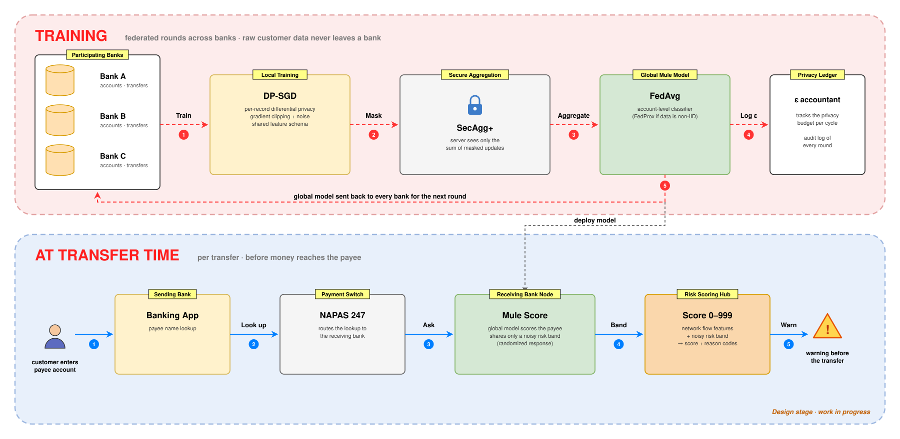

# FedMule — Privacy-Preserving Federated Learning for Mule-Account Detection

[← Back to Portfolio](../index.md)

!!! info "Status: early development"
    The literature review and the system design are done. The prototype on synthetic data is the next step, so there are no results yet.

## Description

In an online scam, victims are tricked into transferring money themselves, and the money is moved on through **mule accounts**: accounts that are rented, bought or opened on someone else's behalf to receive and forward scam proceeds. In Vietnam, losses from online scams in 2025 were estimated at over VND 8,000 billion. Today a mule account is usually flagged only *after* victims report it, by which time the money is gone. **FedMule** aims to let banks jointly learn to recognise newly created mule accounts, *before* they are reported, without any bank disclosing its customers' data.

### Challenge

- **Each bank sees only one side.** A mule account typically receives money from many banks and forwards it within minutes. No single bank has enough signal, but pooling customer data across banks is not legally or commercially acceptable.
- **Reports come too late.** Shared blacklists only work after the first victims have reported an account; a newly opened mule account passes through.
- **Model updates can still leak.** Federated learning keeps raw data local, but individual model updates can reveal information about individual customers, so the updates themselves need protection.

### Approach

- **Federated learning across banks.** Each bank trains an account-level mule classifier on its own data, using a shared feature schema (account age, number of distinct senders, share of money forwarded within an hour, device changes, …). Only model updates leave the bank, aggregated with FedAvg (FedProx if the data is strongly non-IID).
- **Secure aggregation (SecAgg+).** Updates are masked so the aggregation server sees only their sum, never a single bank's update.
- **Differential privacy (DP-SGD).** Each bank clips gradients and adds noise during local training, so the shared model has a published per-record privacy budget ε, tracked in a privacy ledger.
- **A warning at transfer time.** When a customer enters a payee account, the receiving bank scores that account with the shared model and returns only a coarse, randomised risk band. A scoring hub combines it with network-level transfer features and sends the sending bank a risk score with reason codes, so the customer is warned before the money leaves.

## Architecture

- **Training (background):** banks train locally with DP-SGD, mask their updates with SecAgg+, and receive the aggregated global model for the next round. The privacy ledger records the ε spent in every training cycle.
- **At transfer time (real time):** the payee name lookup that already exists in interbank transfers carries the receiving bank's noisy risk band to the scoring hub, which returns a score and reason codes to the sending bank.

**Planned evaluation:** synthetic and public data only (IBM AMLworld, PaySim), comparing rules-only, single-bank, federated and centralised (upper-bound) models on PR-AUC, false-positive rate at fixed recall, calibration, and privacy cost.

**Planned tech stack:** Python · PyTorch · Flower (FedAvg, SecAgg+) · Opacus (DP-SGD) · XGBoost

## Status

- [x] Literature review: federated and privacy-preserving financial-crime detection
- [x] System design and privacy parameters
- [ ] **Prototype on synthetic data (next step)**
- [ ] Evaluation against single-bank and centralised baselines
- [ ] Research paper
