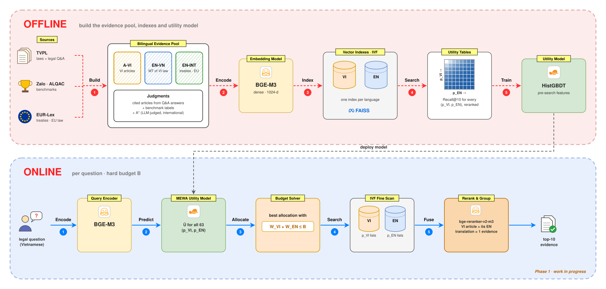

# MEWA — Budgeted Vietnamese–English Legal Evidence Retrieval

[← Back to Portfolio](../index.md)

!!! info "Status: in development"
    The Phase 1 pipeline is implemented. The first run on real data is in progress, so there are no results yet.

## Description

Answering a Vietnamese legal question often needs evidence that is not in Vietnamese: the English version of a Vietnamese law, a treaty Viet Nam is bound by, or an EU regulation that a Vietnamese decree implements. **MEWA (Marginal Evidence Work Allocation)** is the retrieval layer of a cross-lingual legal RAG system. For each question, *before searching*, it decides how to split a fixed ANN search budget between a Vietnamese index and an English index.

### Challenge

- **Evidence is split across languages.** About 15.6k Vietnamese legal documents are listed with an English version on TVPL, and treaty and EU law exists mainly in English. Searching only Vietnamese misses this evidence; searching everything for every question multiplies the cost.
- **Questions differ.** Most are fully answered by Vietnamese law, and a few need English sources. A fixed split wastes budget on both groups.
- **A single multilingual index is not a fix.** Its inverted lists tend to be language-pure, so a global probe order under a tight budget ends up favouring one language.

### Approach

For each question, choose how many IVF lists to probe in each index, *p*<sub>VI</sub>, *p*<sub>EN</sub> ∈ {0, 1, 2, 4, …, 64}:

```text
argmax  Û(q, p_VI, p_EN)   subject to   W_VI(p_VI) + W_EN(p_EN) ≤ B
```

- ***W*** is the exact fine-scan work: the summed size of the probed lists, known before the scan.
- ***U*** is Recall@10 of evidence after union → rerank → grouping by article. A Vietnamese article and its English translation count as one piece of evidence.
- ***Û*** comes from a gradient-boosted model that sees only pre-search signals: coarse centroid scores, list sizes, the query embedding and lexical cues. The best feasible allocation is found by exact enumeration over the 63 options.
- **Baselines:** static splits, separable / additive and ranking models, a single global index, and the per-question oracle.

## Architecture



- **Offline:** builds a bilingual evidence pool with judgments from Vietnamese laws, legal Q&A, benchmarks and EUR-Lex. The pool is encoded with BGE-M3 and indexed in one Faiss IVF index per language. Searching at every probe depth gives a utility table per question, on which the utility model is trained.
- **Online:** for each question, MEWA predicts the utility of all 63 allocations and picks the best one within budget *B*. It then scans both indexes, reranks, and merges a Vietnamese article with its English translation into a single piece of evidence. Answer generation is Phase 2.

**Data:** Vietnamese legal documents and legal Q&A from TVPL, Zalo / ALQAC benchmarks for out-of-domain tests, and EUR-Lex for English evidence.

**Tech stack:** Python · Faiss IVF · BGE-M3 · bge-reranker-v2-m3 · VinAI Translate · scikit-learn · Qwen2.5 on vLLM

## Status

- [x] Research plan and utility-model formulation
- [x] Phase 1 pipeline: data → indexes → utility model → evaluation
- [ ] **Pilot run on real data (in progress)**
- [ ] Full run, final evaluation, ablations
- [ ] Phase 2: legal retriever adaptation and answer generation
